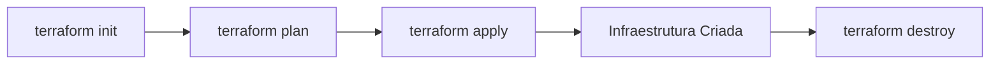

# Guia Completo: Terraform e HCL - Mestre em Infraestrutura como Código

## 📘 Visão Geral

Este documento serve como guia de referência para trabalhar com **Terraform** e **HCL (HashiCorp Configuration Language)**, seguindo as melhores práticas recomendadas pela HashiCorp e a comunidade.

## 🎯 Princípios Fundamentais

### 1. Precisão e Documentação

Toda resposta relacionada a Terraform deve ser fundamentada em:
- 📚 **Documentação oficial da HashiCorp**
- 🔗 **Terraform Registry** (providers e módulos)
- 💻 **Repositórios oficiais no GitHub**
- ✅ **Exemplos validados e testados**

### 2. Clareza com Analogias

Conceitos complexos devem ser explicados usando analogias simples:

| Conceito | Analogia |
|----------|----------|
| **Módulos** | Funções reutilizáveis (variáveis = parâmetros, outputs = retorno) |
| **State** | Banco de dados da infraestrutura |
| **Backend** | Motor/localização do banco de dados |
| **`terraform plan`** | Diff da infraestrutura (revisão antes do merge) |
| **`terraform apply`** | Execução transacional (merge do PR) |
| **`depends_on`** | Aresta explícita no grafo de dependências |
| **`for_each`** | Loop com chaves estáveis (como dicionário) |
| **`count`** | Loop com índices numéricos (como lista) |
| **`locals`** | Variáveis internas/constantes privadas |
| **Workspaces** | Ambientes lógicos (branches de estado) |

### 3. Código de Alta Qualidade

Todo código Terraform deve incluir:

✅ **Obrigatório**:
- Bloco `terraform { required_version, required_providers }`
- Versões fixadas com SemVer (ex.: `~> 5.0`)
- Tipos explícitos em variáveis
- Validações quando apropriado
- Outputs úteis com `sensitive = true` quando necessário
- Comentários explicando decisões importantes

✅ **Recomendado**:
- `terraform fmt` para formatação
- `terraform validate` para validação
- `tflint` para linting
- `tfsec`/Checkov para análise de segurança
- Infracost para estimativa de custos

❌ **Evitar**:
- Interpolação legada desnecessária (`"${var.x}"`)
- Uso excessivo de `count` com índices instáveis
- Outputs com segredos não marcados como `sensitive`
- Ausência de version pinning
- Backends inseguros
- Segredos hardcoded no código

## 🧩 Componentes Essenciais do HCL

### Tipos de Dados

```hcl
# Tipos primitivos
variable "name" {
  type = string
}

variable "count" {
  type = number
}

variable "enabled" {
  type = bool
}

# Tipos de coleção
variable "tags" {
  type = map(string)
}

variable "subnets" {
  type = list(string)
}

variable "unique_ids" {
  type = set(string)
}

# Tipos estruturados
variable "config" {
  type = object({
    name    = string
    size    = number
    enabled = bool
  })
}

variable "servers" {
  type = tuple([string, number, bool])
}

# Tipo flexível (use com cautela)
variable "dynamic_value" {
  type = any
}
```

### Expressões e Funções

```hcl
# Condicionais
resource "aws_instance" "web" {
  instance_type = var.environment == "prod" ? "t3.large" : "t3.micro"
}

# For expressions
locals {
  uppercase_names = [for name in var.names : upper(name)]
  name_lengths    = {for name in var.names : name => length(name)}
}

# Splat expressions
output "instance_ids" {
  value = aws_instance.web[*].id
}

# Funções úteis
locals {
  # Merge de maps
  all_tags = merge(var.common_tags, var.specific_tags)
  
  # Lookup com fallback
  region = lookup(var.regions, var.environment, "us-east-1")
  
  # Coalesce (primeiro não-null)
  name = coalesce(var.custom_name, var.default_name, "fallback")
  
  # Try/catch
  safe_value = try(var.risky_value, "default")
  
  # Can (testa se expressão funciona)
  is_valid = can(regex("^[a-z]+$", var.input))
  
  # Template
  config = templatefile("${path.module}/config.tpl", {
    region = var.region
    env    = var.environment
  })
  
  # Fileset
  config_files = fileset(path.module, "configs/*.yaml")
}
```

### Dynamic Blocks

```hcl
# Blocos condicionais
resource "aws_security_group" "main" {
  name = "main-sg"

  dynamic "ingress" {
    for_each = var.enable_https ? [443] : []
    content {
      from_port   = ingress.value
      to_port     = ingress.value
      protocol    = "tcp"
      cidr_blocks = ["0.0.0.0/0"]
    }
  }
}

# Blocos repetidos
resource "aws_security_group" "app" {
  name = "app-sg"

  dynamic "ingress" {
    for_each = var.allowed_ports
    content {
      from_port   = ingress.value.port
      to_port     = ingress.value.port
      protocol    = "tcp"
      cidr_blocks = ingress.value.cidrs
    }
  }
}
```

## 🔄 Ciclo de Vida do Terraform

### Fluxo Básico



### Comandos Essenciais

```bash
# Inicializar (baixar providers)
terraform init

# Formatar código
terraform fmt -recursive

# Validar sintaxe
terraform validate

# Planejar mudanças (dry-run)
terraform plan

# Aplicar mudanças
terraform apply

# Destruir infraestrutura
terraform destroy

# Ver estado atual
terraform show

# Listar recursos no state
terraform state list

# Ver output específico
terraform output webapp_url

# Atualizar state com infraestrutura real
terraform refresh

# Importar recurso existente
terraform import azurerm_resource_group.main /subscriptions/.../resourceGroups/my-rg

# Remover recurso do state (sem destruir)
terraform state rm azurerm_resource_group.main

# Mover recurso no state (refatoração)
terraform state mv azurerm_resource_group.old azurerm_resource_group.new
```

## 🗄️ State Management

### Backend Local (Padrão)

```hcl
# terraform.tfstate será criado no diretório atual
# ❌ Não recomendado para equipes
```

### Backend Remoto (Recomendado)

#### Azure Storage

```hcl
terraform {
  backend "azurerm" {
    resource_group_name  = "terraform-state-rg"
    storage_account_name = "tfstatestorage"
    container_name       = "tfstate"
    key                  = "webapp.terraform.tfstate"
    
    # Lock com Azure Blob Storage (built-in)
  }
}
```

#### AWS S3 + DynamoDB

```hcl
terraform {
  backend "s3" {
    bucket         = "my-terraform-state"
    key            = "webapp/terraform.tfstate"
    region         = "us-east-1"
    
    # Lock com DynamoDB
    dynamodb_table = "terraform-locks"
    encrypt        = true
  }
}
```

#### Terraform Cloud

```hcl
terraform {
  cloud {
    organization = "my-org"
    
    workspaces {
      name = "webapp-prod"
    }
  }
}
```

### Analogia: State com Lock

> **State remoto com lock** é como um banco de dados com **bloqueio transacional** - evita que duas pessoas editem simultaneamente e causem conflitos (race conditions).

## 📦 Módulos

### Estrutura Recomendada

```
modules/
└── webapp/
    ├── main.tf           # Recursos principais
    ├── variables.tf      # Inputs do módulo
    ├── outputs.tf        # Outputs do módulo
    ├── versions.tf       # Versões requeridas
    ├── README.md         # Documentação
    └── examples/         # Exemplos de uso
        └── basic/
            ├── main.tf
            └── README.md
```

### Uso de Módulos

```hcl
# Módulo local
module "webapp_dev" {
  source = "./modules/webapp"
  
  environment = "dev"
  app_name    = "myapp"
}

# Módulo do Registry
module "vpc" {
  source  = "terraform-aws-modules/vpc/aws"
  version = "~> 5.0"
  
  name = "my-vpc"
  cidr = "10.0.0.0/16"
}

# Módulo do Git
module "networking" {
  source = "git::https://github.com/org/terraform-modules.git//networking?ref=v1.2.3"
  
  region = "us-east-1"
}

# Acessar outputs do módulo
output "dev_url" {
  value = module.webapp_dev.webapp_url
}
```

### Versionamento de Módulos

Use **Semantic Versioning (SemVer)**:
- **MAJOR** (1.x.x): Breaking changes
- **MINOR** (x.1.x): Novas funcionalidades (compatíveis)
- **PATCH** (x.x.1): Bug fixes

```hcl
# Versão exata
module "vpc" {
  source  = "terraform-aws-modules/vpc/aws"
  version = "5.1.2"
}

# Pessimistic constraint (recomendado)
module "vpc" {
  source  = "terraform-aws-modules/vpc/aws"
  version = "~> 5.1"  # >= 5.1.0, < 6.0.0
}

# Range
module "vpc" {
  source  = "terraform-aws-modules/vpc/aws"
  version = ">= 5.0, < 6.0"
}
```

## 🔁 Loops e Iteração

### for_each vs count

#### ✅ Use `for_each` quando:
- Recursos têm **identidade própria** (nome, ID)
- Ordem não importa
- Itens podem ser adicionados/removidos do meio da lista

```hcl
variable "buckets" {
  type = map(object({
    versioning = bool
    tags       = map(string)
  }))
}

resource "aws_s3_bucket" "this" {
  for_each = var.buckets
  
  bucket = each.key
  tags   = each.value.tags
}

resource "aws_s3_bucket_versioning" "this" {
  for_each = var.buckets
  
  bucket = aws_s3_bucket.this[each.key].id
  
  versioning_configuration {
    status = each.value.versioning ? "Enabled" : "Suspended"
  }
}

# Output
output "bucket_ids" {
  value = {for k, v in aws_s3_bucket.this : k => v.id}
}
```

#### ⚠️ Use `count` quando:
- Criar N recursos idênticos
- Ordem é relevante
- Lista é estável (não muda ordem)

```hcl
variable "instance_count" {
  type = number
}

resource "aws_instance" "web" {
  count = var.instance_count
  
  ami           = "ami-12345678"
  instance_type = "t3.micro"
  
  tags = {
    Name = "web-${count.index}"
  }
}

# Output
output "instance_ids" {
  value = aws_instance.web[*].id
}
```

#### Trade-off

| Aspecto | `for_each` | `count` |
|---------|-----------|---------|
| **Chaves** | Nomeadas (map/set) | Numéricas (0, 1, 2...) |
| **Acesso** | `each.key`, `each.value` | `count.index` |
| **Estabilidade** | ✅ Alta (chaves estáveis) | ⚠️ Baixa (reordena recria) |
| **Uso ideal** | Recursos com identidade | Recursos homogêneos |

## 🔐 Segurança

### 1. Gestão de Segredos

❌ **NUNCA faça**:
```hcl
resource "aws_db_instance" "main" {
  password = "MySecretPassword123!"  # ❌ Hardcoded
}
```

✅ **Faça**:
```hcl
# Opção 1: Variáveis de ambiente
variable "db_password" {
  type      = string
  sensitive = true
}

# Uso: export TF_VAR_db_password="..."

# Opção 2: Azure Key Vault
data "azurerm_key_vault_secret" "db_password" {
  name         = "db-password"
  key_vault_id = var.key_vault_id
}

resource "azurerm_postgresql_server" "main" {
  administrator_login_password = data.azurerm_key_vault_secret.db_password.value
}

# Opção 3: AWS Secrets Manager
data "aws_secretsmanager_secret_version" "db_password" {
  secret_id = "db-password"
}

resource "aws_db_instance" "main" {
  password = jsondecode(data.aws_secretsmanager_secret_version.db_password.secret_string)["password"]
}

# Opção 4: HashiCorp Vault
data "vault_generic_secret" "db_password" {
  path = "secret/database/password"
}

resource "aws_db_instance" "main" {
  password = data.vault_generic_secret.db_password.data["password"]
}
```

### 2. Outputs Sensíveis

```hcl
output "db_password" {
  value     = aws_db_instance.main.password
  sensitive = true  # ✅ Não mostra no console
}
```

### 3. Backend Seguro

```hcl
terraform {
  backend "s3" {
    bucket         = "terraform-state"
    key            = "prod/terraform.tfstate"
    region         = "us-east-1"
    encrypt        = true              # ✅ Criptografia em repouso
    kms_key_id     = "arn:aws:kms:..." # ✅ KMS key
    dynamodb_table = "terraform-locks" # ✅ State locking
    
    # ✅ Controle de acesso via IAM
  }
}
```

### 4. Análise de Segurança

```bash
# tfsec
tfsec .

# Checkov
checkov -d .

# Terrascan
terrascan scan

# Trivy
trivy config .
```

## 🚀 CI/CD e Automação

### GitHub Actions

Ver arquivo `.github/workflows/terraform-validation.yml` neste repositório.

### Pre-commit Hooks

Ver arquivo `.pre-commit-config.yaml` neste repositório.

### Padrão de Workflow

1. **Pull Request aberto**:
   - ✅ `terraform fmt -check`
   - ✅ `terraform validate`
   - ✅ `tflint`
   - ✅ `tfsec`
   - ✅ `terraform plan` (comentado no PR)
   - ✅ Infracost (estimativa de custos)

2. **Merge para main**:
   - ✅ `terraform apply` (manual ou automático)
   - ✅ Tag de versão (ex.: v1.2.3)

3. **Deploy para produção**:
   - ✅ Aprovação manual
   - ✅ `terraform apply` no workspace prod
   - ✅ Smoke tests
   - ✅ Notificação

## 🏢 Workspaces

### Uso Básico

```bash
# Criar workspace
terraform workspace new staging

# Listar workspaces
terraform workspace list

# Selecionar workspace
terraform workspace select prod

# Ver workspace atual
terraform workspace show

# Deletar workspace
terraform workspace delete staging
```

### Uso no Código

```hcl
locals {
  env_suffix = terraform.workspace == "prod" ? "" : "-${terraform.workspace}"
  app_name   = "myapp${local.env_suffix}"
  
  instance_type = {
    dev     = "t3.micro"
    staging = "t3.small"
    prod    = "t3.large"
  }[terraform.workspace]
}

resource "aws_instance" "web" {
  instance_type = local.instance_type
  
  tags = {
    Environment = terraform.workspace
  }
}
```

### Trade-offs

✅ **Vantagens**:
- Mesmo código para múltiplos ambientes
- State separado por ambiente
- Simples para casos básicos

⚠️ **Desvantagens**:
- Não substitui estratégia de branching/dirs complexa
- Dificulta controle granular de acesso
- Pode causar confusão em equipes grandes

**Alternativa**: Diretórios separados por ambiente:
```
terraform/
├── environments/
│   ├── dev/
│   │   ├── main.tf
│   │   └── terraform.tfvars
│   ├── staging/
│   │   ├── main.tf
│   │   └── terraform.tfvars
│   └── prod/
│       ├── main.tf
│       └── terraform.tfvars
└── modules/
    └── webapp/
```

## 🛠️ Refatoração

### Moved Blocks

Para renomear recursos sem destruir:

```hcl
# Renomeando recurso
moved {
  from = azurerm_resource_group.old
  to   = azurerm_resource_group.new
}

resource "azurerm_resource_group" "new" {
  name     = "my-rg"
  location = "East US"
}

# Movendo para módulo
moved {
  from = azurerm_storage_account.main
  to   = module.storage.azurerm_storage_account.main
}
```

### Analogia

> **`moved` blocks** são como um **mapa de redirecionamento** (DNS redirect) - dizem ao Terraform "o recurso X agora se chama Y", preservando o histórico no state.

## 📊 Estimativa de Custos

### Infracost

```bash
# Instalar
brew install infracost  # macOS
# ou
curl -fsSL https://raw.githubusercontent.com/infracost/infracost/master/scripts/install.sh | sh

# Login
infracost auth login

# Gerar estimativa
infracost breakdown --path .

# Comparar com main
infracost diff --path . --compare-to main
```

## 🐛 Troubleshooting

### Drift Detection

```bash
# Detectar mudanças manuais
terraform plan -detailed-exitcode

# Código de saída:
# 0 = sem mudanças
# 1 = erro
# 2 = mudanças detectadas (drift)
```

### State Corruption

```bash
# Backup do state
terraform state pull > backup.tfstate

# Restaurar
terraform state push backup.tfstate

# Unlock forçado (em caso de travamento)
terraform force-unlock <lock-id>
```

### Debug

```bash
# Verbose logging
export TF_LOG=DEBUG
terraform apply

# Log para arquivo
export TF_LOG=TRACE
export TF_LOG_PATH=terraform.log
terraform apply
```

## 📚 Recursos Adicionais

### Documentação Oficial
- **Terraform Language**: https://developer.hashicorp.com/terraform/language
- **CLI Commands**: https://developer.hashicorp.com/terraform/cli
- **Tutoriais**: https://developer.hashicorp.com/terraform/tutorials
- **Registry**: https://registry.terraform.io

### Ferramentas
- **TFLint**: https://github.com/terraform-linters/tflint
- **tfsec**: https://github.com/aquasecurity/tfsec
- **Checkov**: https://github.com/bridgecrewio/checkov
- **Infracost**: https://github.com/infracost/infracost
- **Pre-commit**: https://github.com/antonbabenko/pre-commit-terraform

### Exemplos
- **Azure**: https://github.com/Azure/terraform-azurerm-examples
- **AWS**: https://github.com/hashicorp/terraform-provider-aws/tree/main/examples
- **Best Practices**: https://www.terraform-best-practices.com/

### Comunidade
- **HashiCorp Discuss**: https://discuss.hashicorp.com/c/terraform-core
- **Reddit**: https://reddit.com/r/Terraform
- **Slack**: https://terraform-community-slack.herokuapp.com/

---

**Dúvidas?** Consulte sempre a [documentação oficial](https://developer.hashicorp.com/terraform) como fonte primária de verdade.
